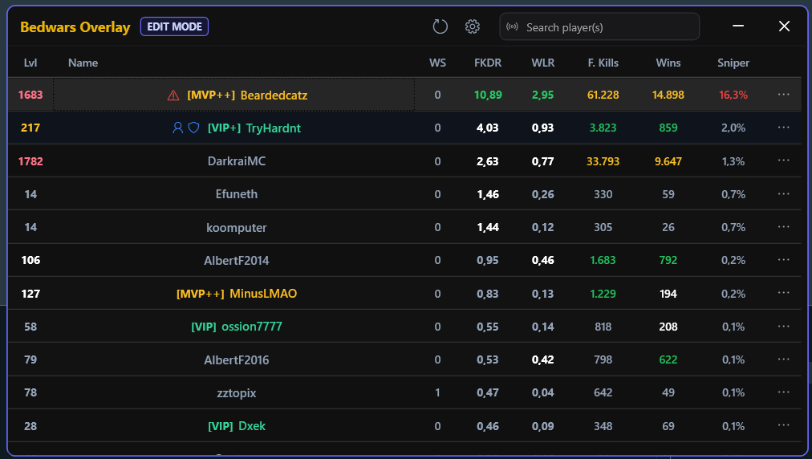
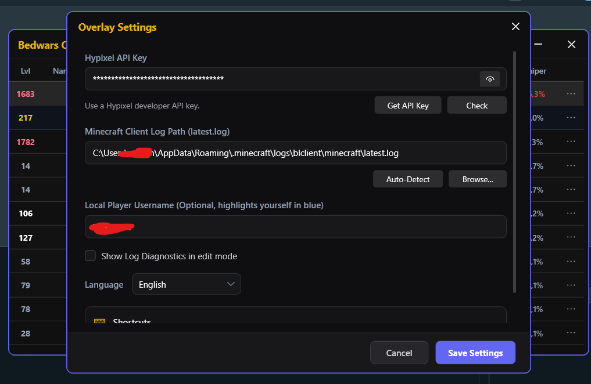

# Bedwars Overlay

**English** | [Türkçe](README.tr.md)

Bedwars Overlay is a small Windows overlay for Hypixel Bed Wars players. It reads your Minecraft log, detects `/who` results, and shows useful Bed Wars stats in a clean overlay while you play.



## What It Does

- Shows players from your `/who` list.
- Reads team prefixes from the visible Minecraft player list with `END` (hold `TAB` and press `END`) and lets you sort the table by team. The OCR engine is bundled with the app.
- Lets you load specific players with `/bwstats`.
- Lets you hide players with `/bwignore`, Settings ignored players, `/p list` party ignore, and self ignore.
- Displays useful Bed Wars stats such as level, winstreak, FKDR, WLR, final kills, wins, and a 0-100 threat score.
- Band the threat score as Low / Medium / High / Extreme, with a per-row tooltip listing the signals behind it (FKDR, WLR, KDR, bed ratio, level, winstreak, alt-account suspicion, repeat opponents).
- Remembers which players were in which game and flags repeat opponents with a `×N` badge on the name column.
- Lets you hide or show individual stat columns from Settings.
- Helps you quickly notice risky lobbies and unusual stats.
- Marks final-killed players with a short red `FINAL KILL` effect, then removes them from the table.
- Clears the current list when a Bed Wars game ends, on both wins and losses.
- Starts in edit mode so you can move and resize the overlay.
- Remembers the overlay position and size between runs.
- Switches into transparent play mode so it does not block Minecraft.
- Hides from the taskbar and Alt-Tab in play mode, and appears there in edit mode.
- Runs from the system tray; closing the overlay hides it, and the tray menu can show it again or exit the app.
- Supports English and Turkish.

## Shortcuts

- `Ctrl+Alt+O`: switch between edit mode and transparent play mode.
- `Ctrl+Alt+H`: hide or show the overlay. Hidden overlays stay available from the system tray.
- `END`: read teams while Minecraft is focused and its player list is open. Hold `TAB` and press `END`; the overlay briefly hides while it captures the game window.

## Overlay Commands

Type these in Minecraft chat. Hypixel will report them as unknown commands, and the overlay reads that log output.

- `/who`: load current game players and apply ignore filters.
- `/bwstats <name...>`: load only the listed players. This ignores filters so you can inspect a player even if they are ignored.
- `/bwignore <name...>`: add players to the ignored players list and remove them from the current overlay.
- `/bwclear`: clear the current overlay list.
- `/bwhelp`: show the command help in the overlay diagnostics/status area.
- `/p list`: update the party list used by the `Ignore party players from /p list` setting.

`/who` is the only reliable way to load the roster: Hypixel never states which team a player is on, and lobby join messages miss everyone who was already in the game. Type it right after the game starts; the status bar prompts you.

## Setup

1. Download the latest version from the [Latest Release](https://github.com/emi-ran/Bedwars-Overlay/releases/latest).
2. Run `BedwarsOverlaySetup-*-win-x64.exe` and launch Bedwars Overlay.
3. If you prefer portable usage, download the `.zip`, extract it, and run `BedwarsOverlay.App.exe`.
4. Open Settings.
5. Add your Hypixel API key.
6. Check or select your Minecraft `latest.log` path.
7. Optionally choose which stat columns are visible, configure ignored players, and tune repeat-opponent highlighting.
8. Join a Bed Wars lobby and type `/who` in Minecraft.



## Getting a Hypixel API Key

You can get an API key from the Hypixel Developer Dashboard:

[https://developer.hypixel.net/](https://developer.hypixel.net/)

The app also includes a button in Settings that opens this page for you.

## Install From Source

Most users should use the latest release. If you want to build it yourself:

```powershell
git clone https://github.com/emi-ran/Bedwars-Overlay.git
cd Bedwars-Overlay
dotnet build "BedwarsOverlay.App\BedwarsOverlay.App.csproj"
dotnet run --project "BedwarsOverlay.App\BedwarsOverlay.App.csproj"
```

Requirements:

- Windows
- .NET 8 SDK

## Building a Release

Install Inno Setup 6 and Visual Studio Build Tools 2022 with the x64 C++ redistributable files if you want to build the installer or portable release package:

[https://jrsoftware.org/isinfo.php](https://jrsoftware.org/isinfo.php)

Publish a non-draft GitHub Release with a `vMAJOR.MINOR.PATCH` tag that matches the version in `BedwarsOverlay.App.csproj`. This triggers `.github/workflows/release.yml`, which builds the installer and portable ZIP and attaches both files to that release. Configure the repository Actions secrets `WINDOWS_SIGNING_CERTIFICATE_BASE64` and `WINDOWS_SIGNING_CERTIFICATE_PASSWORD` first. The current self-signed certificate will not be trusted automatically by other Windows PCs. Create the Base64 secret from the PFX in PowerShell with:

```powershell
[Convert]::ToBase64String([IO.File]::ReadAllBytes((Resolve-Path .\Bedwars-Overlay.pfx))) | gh secret set WINDOWS_SIGNING_CERTIFICATE_BASE64 --repo emi-ran/Bedwars-Overlay
```

Set the password secret without putting the password in shell history:

```powershell
$secure = Read-Host "PFX password" -AsSecureString
$ptr = [Runtime.InteropServices.Marshal]::SecureStringToBSTR($secure)
try {
    [Runtime.InteropServices.Marshal]::PtrToStringBSTR($ptr) | gh secret set WINDOWS_SIGNING_CERTIFICATE_PASSWORD --repo emi-ran/Bedwars-Overlay
} finally {
    [Runtime.InteropServices.Marshal]::ZeroFreeBSTR($ptr)
}
```

Build release artifacts:

```powershell
.\scripts\publish-release.ps1 -Version "1.4.1"
```

Build and sign release artifacts with a `.pfx` certificate:

```powershell
.\scripts\publish-release.ps1 -Version "1.4.1" -Sign -CertificatePath ".\Bedwars-Overlay.pfx"
```

The script prompts for the certificate password. Do not commit `.pfx` or `.p12` files.
By default it signs the app executable, project DLLs, and installer. Use `-SignAllBinaries` only if you want to sign every published `.exe` and `.dll`.

## Notes

- Bedwars Overlay is not affiliated with Hypixel.
- You are responsible for following Hypixel rules and API policies.
- Keep your API key private.
- Use the system tray icon to reopen the overlay or fully exit the app.

## Contributing

Contributions are welcome. See [CONTRIBUTING.md](CONTRIBUTING.md).

## License

GNU Affero General Public License v3.0. See [LICENSE](LICENSE).
